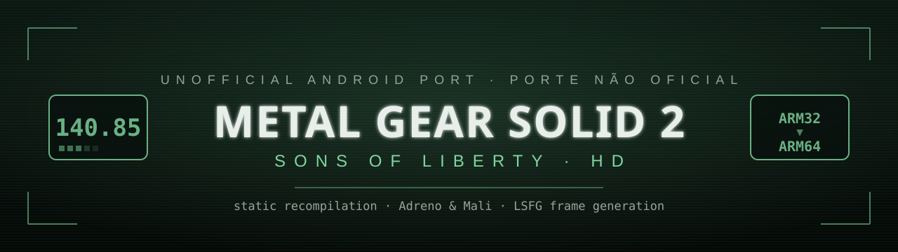
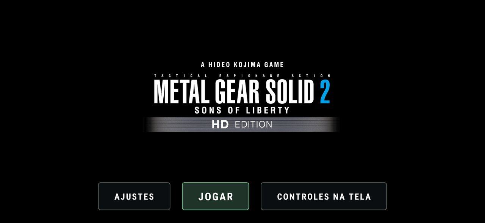
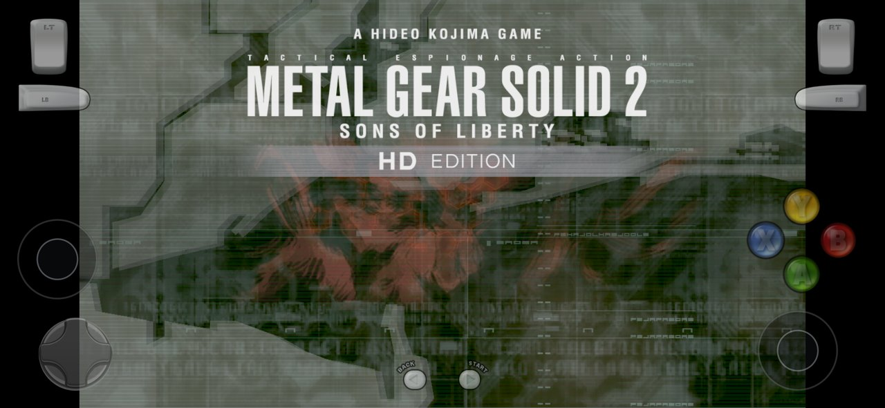
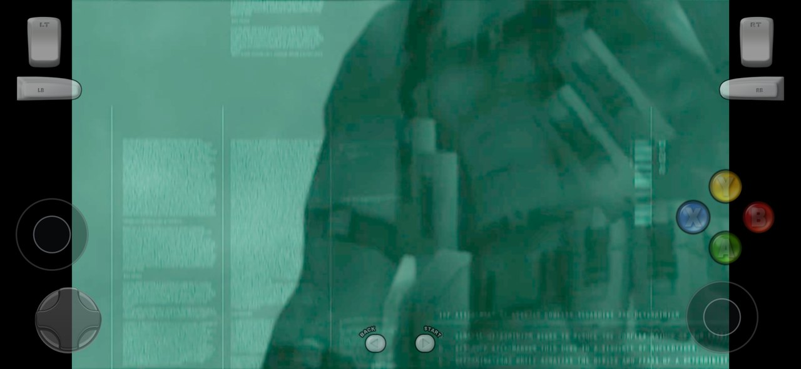
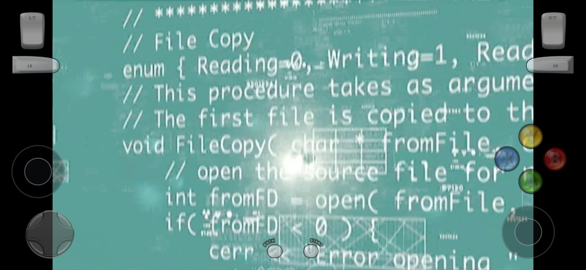
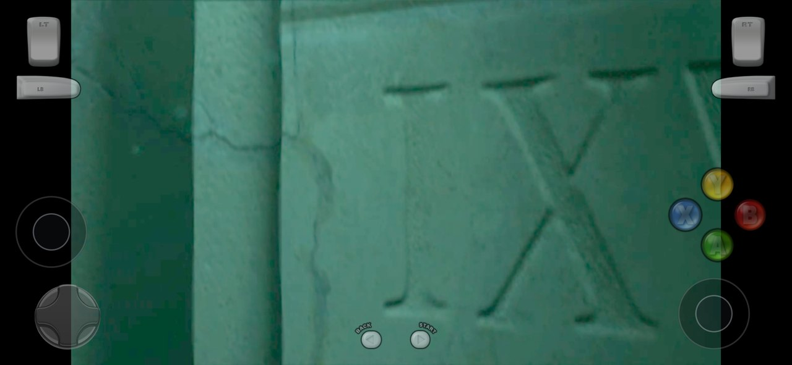
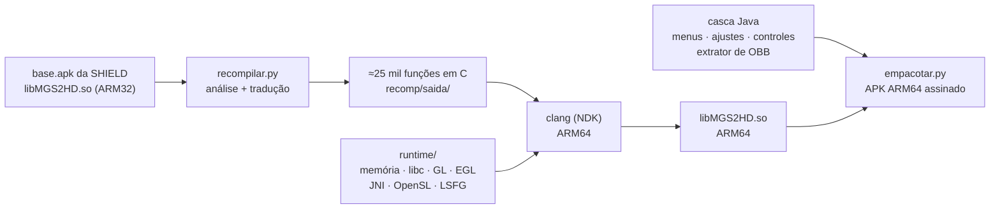
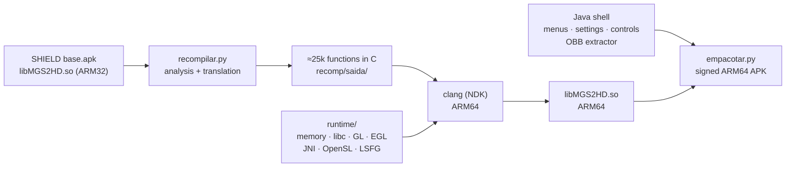

<p align="center">
  
</p>

<p align="center">
  
  
  
  
  
</p>

<p align="center">
  <b><a href="#-português">🇧🇷 Português</a></b> · <b><a href="#-english">🇺🇸 English</a></b>
</p>

---

# 🇧🇷 Português

**Metal Gear Solid 2: Sons of Liberty HD** da NVIDIA SHIELD TV rodando em celulares Android de **64 bits** atuais (Snapdragon e MediaTek).

A versão do SHIELD é um jogo nativo para ARM de **32 bits**. Os processadores novos (como o Snapdragon 8 Elite) **não executam mais código de 32 bits**, então o APK original nem instala. Este projeto faz uma **recompilação estática**: lê o binário ARM32 do jogo, traduz cada função para C e compila de novo para **ARM64**, com um runtime próprio que substitui o sistema do SHIELD (memória, libc, OpenGL, áudio, JNI).

> [!IMPORTANT]
> **Este repositório não contém o jogo.** Nada da Konami nem da NVIDIA está aqui: nem código do jogo, nem APK, nem OBB, nem dados. Para jogar você precisa da **sua própria cópia** do MGS2 HD da SHIELD TV (versão **21.21.1219.GM**: o `base.apk` e as duas OBBs) e montar o APK a partir dela. Projeto de fãs, sem nenhuma ligação com a Konami ou a NVIDIA.

## 📸 Capturas

| Tela inicial | Título com controles na tela |
|:---:|:---:|
|  |  |
| **Abertura** | **Abertura (código)** |
|  |  |

<p align="center"><br><sub>Galaxy S25+ (Snapdragon 8 Elite), 60 FPS, controles na tela.</sub></p>

## ✨ Recursos

- **ARM64 nativo:** o jogo inteiro (≈22 mil funções do jogo + ≈3 mil da biblioteca C++) recompilado para 64 bits, sem emulador.
- **Duas versões do APK:**
  - `MGS2-ARM64.apk` para **Snapdragon / Adreno**;
  - `MGS2-ARM64-Mali.apk` para **MediaTek / Mali** (com ajustes para GPU de ladrilhos).
- **OpenGL de desktop → GLES 3.2:** a camada D3D9→GL da versão SHIELD pede OpenGL de PC; o runtime traduz shaders, formatos de textura e funções.
- **Texturas DXT na CPU** para GPUs que não têm S3TC/RGTC (Mali, PowerVR), decididas automaticamente.
- **Extração automática das OBBs:** na primeira vez, o próprio app tira os ≈7 GB de arquivos de dentro das OBBs, com CRC conferido em cada arquivo e retomada se for interrompido.
- **Controles na tela** com editor de posição, tamanho e opacidade. Controles Bluetooth e USB funcionam direto, e os botões da tela somem sozinhos quando há um controle ligado.
- **Medidor de FPS** com os quadros do jogo e os quadros na tela.
- **Geração de quadros LSFG** (60 → 120), no mesmo esquema do emulador Eden, usando os shaders do *Lossless Scaling* do usuário (veja as limitações).
- **Menus em 7 idiomas**, seguindo o idioma do celular: português, inglês, espanhol, francês, italiano, alemão e japonês.

## 📱 Requisitos

| | |
|---|---|
| **Celular** | Android **8.0+**, processador **64 bits** (arm64-v8a) |
| **GPU** | Adreno (Snapdragon) ou Mali (MediaTek/Exynos antigos); precisa de **OpenGL ES 3.2** |
| **Espaço livre** | **≈12 GB**: 3,7 GB das OBBs + 6,9 GB extraídos + o APK |
| **Arquivos do jogo** | `base.apk` + `main.14.jp.konami.mgs2hd.shield.obb` + `patch.14.jp.konami.mgs2hd.shield.obb`, da SHIELD TV, versão **21.21.1219.GM** |

Testado em: **Galaxy S25+** (Snapdragon 8 Elite, Adreno 830) e **Redmi 13C** (Helio G85, Mali-G52).

## 📖 Tutorial de instalação

### Passo 1: copiar os arquivos do jogo da sua SHIELD TV

Você precisa de três arquivos da **sua** SHIELD com o jogo instalado:

| Arquivo | Tamanho | Onde fica na SHIELD |
|---|---|---|
| `base.apk` | ≈13 MB | pasta do app (o comando abaixo mostra) |
| `main.14.jp.konami.mgs2hd.shield.obb` | ≈2,1 GB | `/sdcard/Android/obb/jp.konami.mgs2hd.shield/` |
| `patch.14.jp.konami.mgs2hd.shield.obb` | ≈1,6 GB | `/sdcard/Android/obb/jp.konami.mgs2hd.shield/` |

1. Na SHIELD: **Configurações → Preferências do dispositivo → Sobre** e toque 7 vezes em **Build** para liberar as opções de desenvolvedor.
2. Em **Opções do desenvolvedor**, ligue a **Depuração de rede** (ou a USB).
3. No PC, com o [Android Platform Tools](https://developer.android.com/tools/releases/platform-tools) instalado:

```bash
adb connect IP_DA_SHIELD:5555
adb shell pm path jp.konami.mgs2hd.shield
```

4. O comando acima mostra algo como `package:/data/app/.../base.apk`. Copie esse arquivo e as OBBs para uma pasta **`jogo/`** dentro deste repositório:

```bash
mkdir jogo
adb pull /data/app/CAMINHO_QUE_APARECEU/base.apk jogo/
adb pull /sdcard/Android/obb/jp.konami.mgs2hd.shield/main.14.jp.konami.mgs2hd.shield.obb jogo/
adb pull /sdcard/Android/obb/jp.konami.mgs2hd.shield/patch.14.jp.konami.mgs2hd.shield.obb jogo/
```

### Passo 2: montar o APK

Como o APK contém o código do jogo, ele **não é distribuído**: cada pessoa monta o seu a partir dos próprios arquivos. As instruções completas estão em [**Como compilar**](#-como-compilar). O resultado fica em `recomp/build/`:

- **Snapdragon / Adreno:** `MGS2-ARM64.apk`
- **MediaTek / Mali:** `MGS2-ARM64-Mali.apk`

> Não sabe qual é a sua GPU? Instale o app *CPU-Z* e veja em **SoC → GPU**. Adreno = Snapdragon; Mali = MediaTek/Exynos.

### Passo 3: instalar o APK no celular

Escolha uma das formas:

- **Pelo cabo (adb):** `adb install MGS2-ARM64.apk`
- **Pelo celular:** copie o APK para o celular, abra pelo gerenciador de arquivos e permita **"Instalar apps desconhecidos"** quando o Android pedir.

> **Xiaomi / Redmi / POCO:** para instalar pelo cabo, ative em **Configurações → Configurações adicionais → Opções do desenvolvedor** a opção **"Instalar via USB"**. Sem ela aparece `INSTALL_FAILED_USER_RESTRICTED`.

### Passo 4: colocar as OBBs no lugar certo ⚠️

As duas OBBs vão **exatamente** nesta pasta do celular, com estes nomes:

```
Armazenamento interno/
└── Android/
    └── obb/
        └── jp.konami.mgs2hd.shield/            ← crie esta pasta se não existir
            ├── main.14.jp.konami.mgs2hd.shield.obb
            └── patch.14.jp.konami.mgs2hd.shield.obb
```

**Instale o APK antes** (passo 3) e depois copie as OBBs, de uma destas formas:

**A) Pelo PC com cabo USB (recomendado)**
1. Conecte o celular e escolha **"Transferência de arquivos"** na notificação USB.
2. No Explorador de Arquivos do Windows, abra **Armazenamento interno → Android → obb**.
3. Crie a pasta `jp.konami.mgs2hd.shield` (se ainda não existir).
4. Copie as duas OBBs para dentro dela e espere terminar (são ≈3,7 GB).

**B) Pelo adb**
```bash
adb shell mkdir -p /sdcard/Android/obb/jp.konami.mgs2hd.shield
adb push jogo/main.14.jp.konami.mgs2hd.shield.obb /sdcard/Android/obb/jp.konami.mgs2hd.shield/
adb push jogo/patch.14.jp.konami.mgs2hd.shield.obb /sdcard/Android/obb/jp.konami.mgs2hd.shield/
```
Ou, de uma vez (instala o APK, envia as OBBs e **não** abre o jogo):
```bash
bash instalar.sh recomp/build/MGS2-ARM64.apk
```

**C) Só pelo celular**
A partir do Android 11, os gerenciadores de arquivos comuns não conseguem mais entrar em `Android/obb`. Use um gerenciador com acesso via **Shizuku** (por exemplo, MiXplorer ou ZArchiver com Shizuku) ou prefira as formas A ou B.

> [!WARNING]
> **Não copie os arquivos já extraídos** (pastas `assets`, `us`, `textures`…) para `Android/data` pelo PC ou pelo adb. Em alguns aparelhos, como os da Xiaomi, eles ficam com o dono errado, o jogo não consegue ler e fecha logo na abertura. Copie **só as OBBs** e deixe o app extrair.

### Passo 5: primeira abertura

1. Abra **MGS2 HD** e toque em **Jogar**.
2. Aparece a tela **"Preparando os dados do jogo"**: o app tira os ≈32 mil arquivos de dentro das OBBs, com barra de progresso e tempo restante.
   - Leva de 1 a 5 minutos, dependendo do celular. Deixe o app aberto; a tela fica acesa sozinha.
   - Se for interrompido, ao tocar em Jogar de novo ele **continua de onde parou**.
3. No fim, o jogo abre sozinho. Nas próximas vezes, vai direto para o jogo.

> Depois da extração as OBBs não são mais lidas pelo jogo. Mesmo assim, mantenha-as: se os dados forem apagados (ao limpar os dados do app, por exemplo), o app extrai de novo a partir delas.

### Passo 6: ajustes

Na tela inicial, toque em **Ajustes**:

| Ajuste | Opções | O que faz |
|---|---|---|
| **Limite de quadros** | 30 · **60** · Sem limite | O MGS2 foi feito para 60. "Sem limite" pode **acelerar** o jogo |
| **Imagem** | **16:9** · Esticar | 16:9 mantém a proporção (faixas pretas nas laterais); Esticar ocupa a tela toda |
| **Medidor de FPS** | ligado/desligado | Mostra no canto os FPS do jogo e, com o LSFG, os FPS da tela |
| **Geração de quadros (LSFG)** | **Desligada** · 2x (120) | Cria um quadro intermediário: 60 → 120 sem acelerar o jogo |
| **Precisão do movimento** | **100%** · 75% · 50% | Menor = GPU mais livre, mais erro nas bordas de objetos rápidos |
| **Lossless.dll** | Importar | Escolhe o `Lossless.dll` do seu Lossless Scaling |
| **Mostrar controles na tela** | **Automático** · Sempre · Nunca | Automático esconde os botões quando há controle físico ligado |
| **Opacidade dos botões** | 10–100% | Transparência dos botões por cima do jogo |
| **Vibrar ao tocar** | ligado/desligado | Vibração curta em cada botão |

### Passo 7: controles

- **Controle Bluetooth/USB** (padrão Xbox, como os 8BitDo, ou DualSense): conecte e jogue. Os botões da tela somem sozinhos.
- **Controles na tela:** em **Controles na tela** (tela inicial), arraste cada botão para mover, use pinça para mudar o tamanho e ajuste o tamanho geral e a opacidade. Depois toque em **Salvar**.

### Geração de quadros (LSFG): limitações

O LSFG usa os shaders do programa **Lossless Scaling** (pago, na Steam), lidos do **seu** `Lossless.dll`; o arquivo é só lido, nunca executado. Para importar: no PC, abra **Steam → Lossless Scaling → Gerenciar → Ver arquivos locais**, copie o `Lossless.dll` para o celular e use **Ajustes → Lossless.dll → Importar**.

> [!NOTE]
> Esta versão aceita o `Lossless.dll` que traz os shaders já em **SPIR-V**. A versão atual do Lossless Scaling (**3.2.1**) traz **só DXBC** e ainda **não é suportada**: com ela o jogo roda normalmente, sem a geração de quadros. A geração também precisa de Vulkan 1.2 com `nullDescriptor`, `vulkanMemoryModel` e `shaderFloat16`.

## 🛠️ Solução de problemas

| Problema | Solução |
|---|---|
| `INSTALL_FAILED_USER_RESTRICTED` ao instalar | Xiaomi: ative **"Instalar via USB"** nas opções do desenvolvedor |
| "Faltam as OBBs do jogo" | Confira a pasta e os **nomes exatos** do passo 4 |
| "Espaço insuficiente" | Libere ≈7 GB e toque em **Tentar de novo** |
| O jogo fecha logo ao abrir | Você copiou arquivos extraídos pelo PC/adb? Apague as pastas de `Android/data/jp.konami.mgs2hd.shield/files/` (menos `saveData`) e deixe o app extrair |
| Os botões da tela não aparecem | **Ajustes → Mostrar controles na tela → Sempre** |
| Jogo acelerado | **Ajustes → Limite de quadros → 60** |
| Ver o log técnico | `adb logcat -s MGS2-RT MGS2-stdout DEBUG` |

## ⚙️ Como funciona



- **Recompilador** (`recomp/recompilar.py`, `gerar*.py`, `ual.py`): acha as funções (tabelas de exceção, alvos de `bl`, ponteiros, tabelas de salto ARM e Thumb), lê o texto do Capstone e emite C. Os registradores viram variáveis locais, que o clang põe nos registradores do ARM64.
- **Testes:**
  - `diferencial.py` compara instrução por instrução com o Unicorn;
  - `fuzz_funcoes.py` compara funções inteiras com estados aleatórios;
  - `medir_abi.py` e `medir_bandeiras.py` validam as otimizações de chamada.
- **Runtime** (`recomp/runtime/`): memória de 4 GB do jogo, pontes para a libc do Android, `pthread`, OpenGL de desktop sobre GLES 3.2 (`gl_desktop.c`, `gl_shader.c`, `gl_formato.c`), DXT/RGTC na CPU (`s3tc.c`), áudio OpenSL, JNI falso para o Java da NVIDIA Forge, e LSFG em Vulkan (`lsfg_vk.cpp`, `lsfg_gl.c`).
- **Casca Java** (`recomp/java_tela/`): menu, ajustes, editor de controles, controles na tela, medidor de FPS, extrator de OBB e traduções (`Textos.java`).

## 🧱 Como compilar

**Ambiente testado:** Windows 11 com Git Bash. Os scripts também devem funcionar em Linux e macOS.

1. **Instale:**
   - [Python 3.11+](https://www.python.org/) e depois:
     ```bash
     pip install capstone unicorn pillow
     ```
   - [Android SDK](https://developer.android.com/studio) com **NDK r27+**, **Build-Tools** e uma **Platform** (pelo SDK Manager do Android Studio);
   - **JDK 17+**.
2. **Confira** se as ferramentas foram encontradas:
   ```bash
   python recomp/caminhos.py
   ```
   Se algo aparecer como `NAO ENCONTRADO`, defina `ANDROID_HOME`, `ANDROID_NDK_HOME` ou `JAVA_HOME`.
3. **Coloque os arquivos do seu jogo** em `jogo/` (passo 1 do tutorial) e extraia as bibliotecas ARM32:
   ```bash
   python recomp/preparar.py
   ```
4. **Recompile** o jogo. A primeira vez leva uns 10 minutos e gera `recomp/saida/`:
   ```bash
   python recomp/recompilar.py
   ```
5. **Compile a casca Java:**
   ```bash
   bash recomp/java_tela/compilar.sh
   ```
6. **Compile para ARM64 e monte o APK:**
   ```bash
   python recomp/construir_android.py && python recomp/empacotar.py
   MGS2_SABOR=mali python recomp/construir_android.py && MGS2_SABOR=mali python recomp/empacotar.py
   ```
   A primeira linha gera o APK **Adreno**; a segunda, o **Mali**.
7. Os APKs ficam em `recomp/build/`. Na primeira vez, o `empacotar.py` cria uma chave de assinatura própria (`recomp/assinatura.jks`). **Guarde essa chave**: sem ela, as próximas versões não instalam por cima da anterior.

> [!NOTE]
> A versão SHIELD tem uma camada de licença exclusiva do aparelho (NVSI). O componente que faz o papel dela **não faz parte deste repositório**.

## 📂 Estrutura

```
├── extrair_obb.py          extrai as OBBs no PC (opcional; o app já faz isso)
├── instalar.sh             instala APK + OBBs pelo adb, sem abrir o jogo
├── docs/                   banner e capturas
└── recomp/
    ├── caminhos.py         onde estão SDK/NDK/JDK e os arquivos do jogo
    ├── preparar.py         tira as bibliotecas ARM32 do base.apk
    ├── recompilar.py       análise + emissão de C (gerar.py, gerar_vfp.py, ual.py…)
    ├── construir_android.py / empacotar.py   compila e monta o APK
    ├── runtime/            o "sistema" do jogo em ARM64
    ├── java_tela/          menus, ajustes, controles, extrator, traduções
    └── lsfg_teste/         testes da geração de quadros (PC, Vulkan com validação)
```

## 🙏 Créditos

- **Geração de quadros:** implementação portada do [emulador Eden](https://git.eden-emu.dev/eden-emu/eden) (PR #4263), baseada no **lsfg-vk** de PancakeTAS. Os shaders são do **Lossless Scaling** (THS), lidos da cópia do usuário.
- [Capstone](https://www.capstone-engine.org/) (desmontagem) e [Unicorn](https://www.unicorn-engine.org/) (testes).
- *Metal Gear Solid* é marca da Konami Digital Entertainment. *SHIELD* é marca da NVIDIA. Este projeto não tem ligação com nenhuma das duas.

## 📜 Licença

O código deste repositório está sob a [GPL-3.0](LICENSE), por incluir código derivado do Eden e do lsfg-vk (GPL-3.0).

---

# 🇺🇸 English

**Metal Gear Solid 2: Sons of Liberty HD** from the NVIDIA SHIELD TV running on modern **64-bit** Android phones (Snapdragon and MediaTek).

The SHIELD release is a native **32-bit** ARM game. New chips (such as the Snapdragon 8 Elite) **can no longer run 32-bit code**, so the original APK won't even install. This project does a **static recompilation**: it reads the game's ARM32 binary, translates every function to C and compiles it again for **ARM64**, with its own runtime replacing the SHIELD system (memory, libc, OpenGL, audio, JNI).

> [!IMPORTANT]
> **This repository does not contain the game.** Nothing from Konami or NVIDIA is here: no game code, no APK, no OBB, no data. To play, you need **your own copy** of MGS2 HD for the SHIELD TV (version **21.21.1219.GM**: the `base.apk` and both OBBs) and build the APK from it. Fan project, not affiliated with Konami or NVIDIA.

## 📸 Screenshots

| Start screen | Title screen with on-screen controls |
|:---:|:---:|
|  |  |
| **Intro** | **Intro (code)** |
|  |  |

## ✨ Features

- **Native ARM64:** the whole game (≈22k game functions + ≈3k C++ library functions) recompiled to 64-bit, no emulator.
- **Two APK flavors:**
  - `MGS2-ARM64.apk` for **Snapdragon / Adreno**;
  - `MGS2-ARM64-Mali.apk` for **MediaTek / Mali** (tuned for tile-based GPUs).
- **Desktop OpenGL → GLES 3.2:** the SHIELD build's D3D9→GL layer asks for PC OpenGL; the runtime translates shaders, texture formats and functions.
- **CPU-side DXT textures** for GPUs without S3TC/RGTC (Mali, PowerVR), picked automatically.
- **Automatic OBB extraction:** on first launch the app itself unpacks the ≈7 GB of files from the OBBs, with a CRC check on every file and resume if interrupted.
- **On-screen controls** with an editor for position, size and opacity. Bluetooth and USB controllers work out of the box, and the on-screen buttons hide themselves when a controller is connected.
- **FPS counter** showing game frames and frames on screen.
- **LSFG frame generation** (60 → 120), the same scheme as the Eden emulator, using the user's own *Lossless Scaling* shaders (see the limitations).
- **Menus in 7 languages**, following the phone's language: Portuguese, English, Spanish, French, Italian, German and Japanese.

## 📱 Requirements

| | |
|---|---|
| **Phone** | Android **8.0+**, **64-bit** CPU (arm64-v8a) |
| **GPU** | Adreno (Snapdragon) or Mali (MediaTek/older Exynos); needs **OpenGL ES 3.2** |
| **Free space** | **≈12 GB**: 3.7 GB of OBBs + 6.9 GB extracted + the APK |
| **Game files** | `base.apk` + `main.14.jp.konami.mgs2hd.shield.obb` + `patch.14.jp.konami.mgs2hd.shield.obb`, from the SHIELD TV, version **21.21.1219.GM** |

Tested on: **Galaxy S25+** (Snapdragon 8 Elite, Adreno 830) and **Redmi 13C** (Helio G85, Mali-G52).

## 📖 Installation guide

### Step 1: copy the game files from your SHIELD TV

You need three files from **your** SHIELD with the game installed:

| File | Size | Location on the SHIELD |
|---|---|---|
| `base.apk` | ≈13 MB | the app folder (the command below shows it) |
| `main.14.jp.konami.mgs2hd.shield.obb` | ≈2.1 GB | `/sdcard/Android/obb/jp.konami.mgs2hd.shield/` |
| `patch.14.jp.konami.mgs2hd.shield.obb` | ≈1.6 GB | `/sdcard/Android/obb/jp.konami.mgs2hd.shield/` |

1. On the SHIELD: **Settings → Device Preferences → About**, tap **Build** 7 times to unlock developer options.
2. In **Developer options**, enable **Network debugging** (or USB debugging).
3. On the PC, with [Android Platform Tools](https://developer.android.com/tools/releases/platform-tools) installed:

```bash
adb connect SHIELD_IP:5555
adb shell pm path jp.konami.mgs2hd.shield
```

4. The command above prints something like `package:/data/app/.../base.apk`. Copy that file and the OBBs into a **`jogo/`** folder inside this repository:

```bash
mkdir jogo
adb pull /data/app/THE_PATH_IT_PRINTED/base.apk jogo/
adb pull /sdcard/Android/obb/jp.konami.mgs2hd.shield/main.14.jp.konami.mgs2hd.shield.obb jogo/
adb pull /sdcard/Android/obb/jp.konami.mgs2hd.shield/patch.14.jp.konami.mgs2hd.shield.obb jogo/
```

### Step 2: build the APK

Since the APK contains the game's code, it is **not distributed**: everyone builds their own from their own files. Full instructions are in [**Building**](#-building). The result lands in `recomp/build/`:

- **Snapdragon / Adreno:** `MGS2-ARM64.apk`
- **MediaTek / Mali:** `MGS2-ARM64-Mali.apk`

> Not sure which GPU you have? Install *CPU-Z* and check **SoC → GPU**. Adreno = Snapdragon; Mali = MediaTek/Exynos.

### Step 3: install the APK on the phone

Pick one:

- **Over USB (adb):** `adb install MGS2-ARM64.apk`
- **On the phone:** copy the APK over, open it with the file manager and allow **"Install unknown apps"** when Android asks.

> **Xiaomi / Redmi / POCO:** to install over USB, enable **"Install via USB"** in **Settings → Additional settings → Developer options**. Without it you get `INSTALL_FAILED_USER_RESTRICTED`.

### Step 4: put the OBBs in the right place ⚠️

Both OBBs go **exactly** into this folder on the phone, with these names:

```
Internal storage/
└── Android/
    └── obb/
        └── jp.konami.mgs2hd.shield/            ← create this folder if it doesn't exist
            ├── main.14.jp.konami.mgs2hd.shield.obb
            └── patch.14.jp.konami.mgs2hd.shield.obb
```

**Install the APK first** (step 3), then copy the OBBs in one of these ways:

**A) From the PC over USB (recommended)**
1. Plug the phone in and choose **"File transfer"** in the USB notification.
2. In Windows File Explorer, open **Internal storage → Android → obb**.
3. Create the folder `jp.konami.mgs2hd.shield` (if it isn't there yet).
4. Copy both OBBs into it and wait for it to finish (≈3.7 GB).

**B) With adb**
```bash
adb shell mkdir -p /sdcard/Android/obb/jp.konami.mgs2hd.shield
adb push jogo/main.14.jp.konami.mgs2hd.shield.obb /sdcard/Android/obb/jp.konami.mgs2hd.shield/
adb push jogo/patch.14.jp.konami.mgs2hd.shield.obb /sdcard/Android/obb/jp.konami.mgs2hd.shield/
```
Or all at once (installs the APK, pushes the OBBs and does **not** launch the game):
```bash
bash instalar.sh recomp/build/MGS2-ARM64.apk
```

**C) On the phone only**
Since Android 11, regular file managers can't open `Android/obb`. Use one with **Shizuku** access (e.g. MiXplorer or ZArchiver with Shizuku), or go with A or B.

> [!WARNING]
> **Do not copy already-extracted files** (the `assets`, `us`, `textures`… folders) into `Android/data` from the PC or with adb. On some phones, such as Xiaomi's, they end up with the wrong owner, the game can't read them and closes right at startup. Copy **only the OBBs** and let the app extract them.

### Step 5: first launch

1. Open **MGS2 HD** and tap **Play**.
2. The **"Preparing game data"** screen appears: the app unpacks the ≈32k files from the OBBs, with a progress bar and time remaining.
   - It takes 1 to 5 minutes depending on the phone. Keep the app open; the screen stays on by itself.
   - If it gets interrupted, tapping Play again **resumes where it stopped**.
3. When it's done, the game starts by itself. From then on, it goes straight to the game.

> After extraction the game no longer reads the OBBs. Keep them anyway: if the data gets wiped (by clearing the app's data, for example), the app extracts again from them.

### Step 6: settings

On the start screen, tap **Settings**:

| Setting | Options | What it does |
|---|---|---|
| **Frame limit** | 30 · **60** · Unlimited | MGS2 was made for 60. "Unlimited" can **speed the game up** |
| **Image** | **16:9** · Stretch | 16:9 keeps the aspect ratio (black bars on the sides); Stretch fills the whole screen |
| **FPS counter** | on/off | Shows game FPS in the corner and, with LSFG, screen FPS |
| **Frame generation (LSFG)** | **Off** · 2x (120) | Creates an in-between frame: 60 → 120 without speeding the game up |
| **Motion accuracy** | **100%** · 75% · 50% | Lower = lighter on the GPU, more errors around fast-moving objects |
| **Lossless.dll** | Import | Picks the `Lossless.dll` from your Lossless Scaling |
| **Show on-screen controls** | **Automatic** · Always · Never | Automatic hides the buttons when a physical controller is connected |
| **Button opacity** | 10–100% | How see-through the buttons are over the game |
| **Vibrate on touch** | on/off | Short vibration on every button |

### Step 7: controls

- **Bluetooth/USB controller** (Xbox layout, such as 8BitDo pads, or DualSense): connect it and play. The on-screen buttons hide themselves.
- **On-screen controls:** in **On-screen controls** (start screen), drag each button to move it, pinch to resize, and adjust the overall size and opacity. Then tap **Save**.

### Frame generation (LSFG): limitations

LSFG uses the shaders from **Lossless Scaling** (paid, on Steam), read from **your** `Lossless.dll`; the file is only read, never executed. To import it: on the PC, open **Steam → Lossless Scaling → Manage → Browse local files**, copy `Lossless.dll` to the phone and use **Settings → Lossless.dll → Import**.

> [!NOTE]
> This version accepts a `Lossless.dll` that ships the shaders already in **SPIR-V**. The current Lossless Scaling (**3.2.1**) ships **DXBC only** and is **not supported yet**: with it the game runs normally, without frame generation. Frame generation also needs Vulkan 1.2 with `nullDescriptor`, `vulkanMemoryModel` and `shaderFloat16`.

## 🛠️ Troubleshooting

| Problem | Fix |
|---|---|
| `INSTALL_FAILED_USER_RESTRICTED` when installing | Xiaomi: enable **"Install via USB"** in developer options |
| "The game OBBs are missing" | Check the folder and the **exact names** from step 4 |
| "Not enough space" | Free ≈7 GB and tap **Try again** |
| The game closes right after opening | Did you copy extracted files from the PC/adb? Delete the folders in `Android/data/jp.konami.mgs2hd.shield/files/` (except `saveData`) and let the app extract |
| On-screen buttons don't show up | **Settings → Show on-screen controls → Always** |
| Game runs too fast | **Settings → Frame limit → 60** |
| Technical log | `adb logcat -s MGS2-RT MGS2-stdout DEBUG` |

## ⚙️ How it works



- **Recompiler** (`recomp/recompilar.py`, `gerar*.py`, `ual.py`): finds functions (exception tables, `bl` targets, pointers, ARM and Thumb jump tables), reads Capstone's text output and emits C. Registers become local variables, which clang maps onto ARM64 registers.
- **Tests:**
  - `diferencial.py` compares instruction by instruction against Unicorn;
  - `fuzz_funcoes.py` compares whole functions with random states;
  - `medir_abi.py` and `medir_bandeiras.py` validate the call optimizations.
- **Runtime** (`recomp/runtime/`): the game's 4 GB memory, bridges to Android's libc, `pthread`, desktop OpenGL on top of GLES 3.2 (`gl_desktop.c`, `gl_shader.c`, `gl_formato.c`), CPU DXT/RGTC (`s3tc.c`), OpenSL audio, a fake JNI for the NVIDIA Forge Java code, and Vulkan LSFG (`lsfg_vk.cpp`, `lsfg_gl.c`).
- **Java shell** (`recomp/java_tela/`): menu, settings, controls editor, on-screen controls, FPS counter, OBB extractor and translations (`Textos.java`).

## 🧱 Building

**Tested environment:** Windows 11 with Git Bash. The scripts should also work on Linux and macOS.

1. **Install:**
   - [Python 3.11+](https://www.python.org/), then:
     ```bash
     pip install capstone unicorn pillow
     ```
   - the [Android SDK](https://developer.android.com/studio) with **NDK r27+**, **Build-Tools** and a **Platform** (from Android Studio's SDK Manager);
   - **JDK 17+**.
2. **Check** that the tools were found:
   ```bash
   python recomp/caminhos.py
   ```
   If anything shows `NAO ENCONTRADO` (not found), set `ANDROID_HOME`, `ANDROID_NDK_HOME` or `JAVA_HOME`.
3. **Put your game files** in `jogo/` (step 1 of the guide) and extract the ARM32 libraries:
   ```bash
   python recomp/preparar.py
   ```
4. **Recompile** the game. The first run takes about 10 minutes and creates `recomp/saida/`:
   ```bash
   python recomp/recompilar.py
   ```
5. **Build the Java shell:**
   ```bash
   bash recomp/java_tela/compilar.sh
   ```
6. **Compile for ARM64 and package the APK:**
   ```bash
   python recomp/construir_android.py && python recomp/empacotar.py
   MGS2_SABOR=mali python recomp/construir_android.py && MGS2_SABOR=mali python recomp/empacotar.py
   ```
   The first line builds the **Adreno** APK; the second, the **Mali** one.
7. The APKs end up in `recomp/build/`. On the first run, `empacotar.py` creates your own signing key (`recomp/assinatura.jks`). **Keep that key**: without it, later builds won't install over the previous one.

> [!NOTE]
> The SHIELD build has a device-exclusive licensing layer (NVSI). The component that stands in for it is **not part of this repository**.

## 🙏 Credits

- **Frame generation:** implementation ported from the [Eden emulator](https://git.eden-emu.dev/eden-emu/eden) (PR #4263), based on **lsfg-vk** by PancakeTAS. The shaders are from **Lossless Scaling** (THS), read from the user's own copy.
- [Capstone](https://www.capstone-engine.org/) (disassembly) and [Unicorn](https://www.unicorn-engine.org/) (testing).
- *Metal Gear Solid* is a trademark of Konami Digital Entertainment. *SHIELD* is a trademark of NVIDIA. This project is not affiliated with either.

## 📜 License

The code in this repository is licensed under the [GPL-3.0](LICENSE), as it includes code derived from Eden and lsfg-vk (GPL-3.0).
